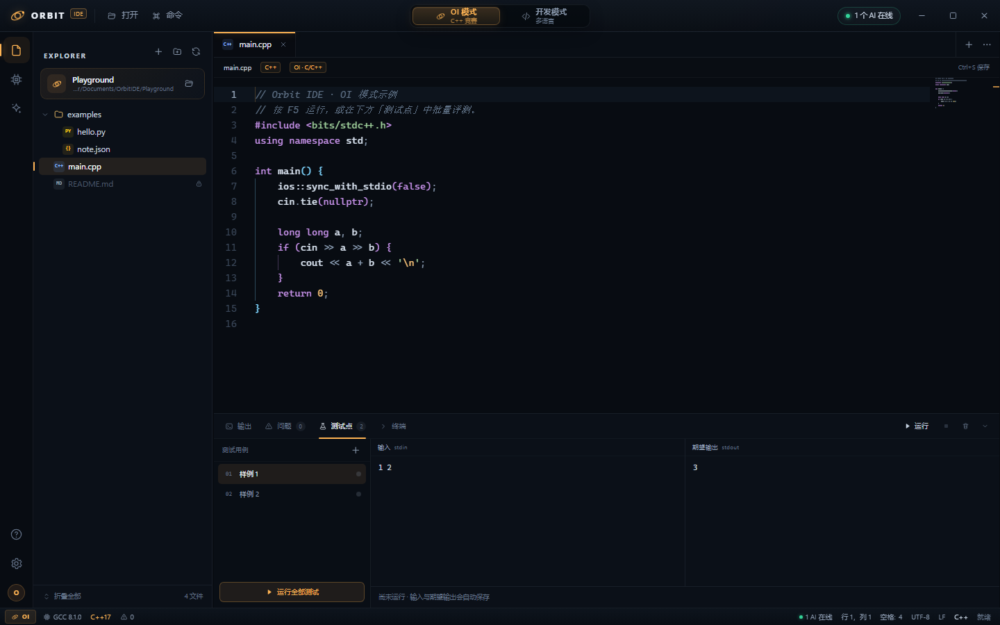
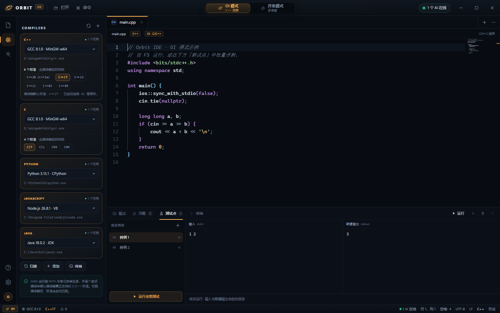
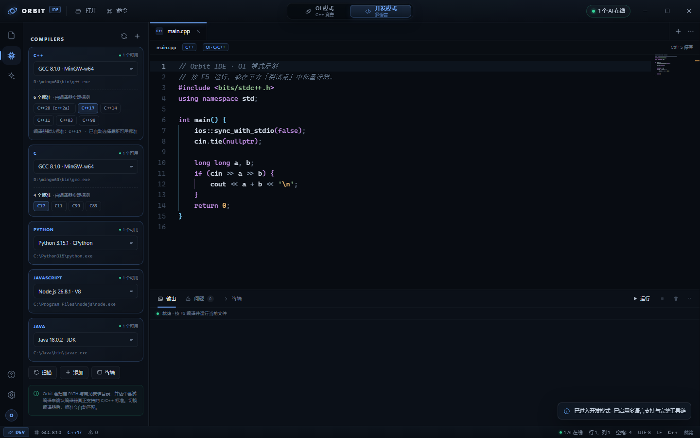
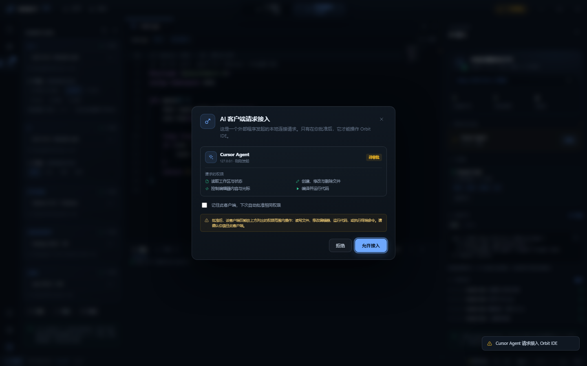
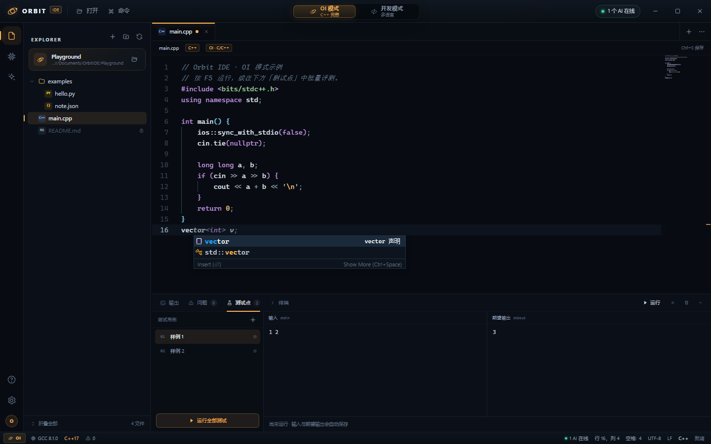
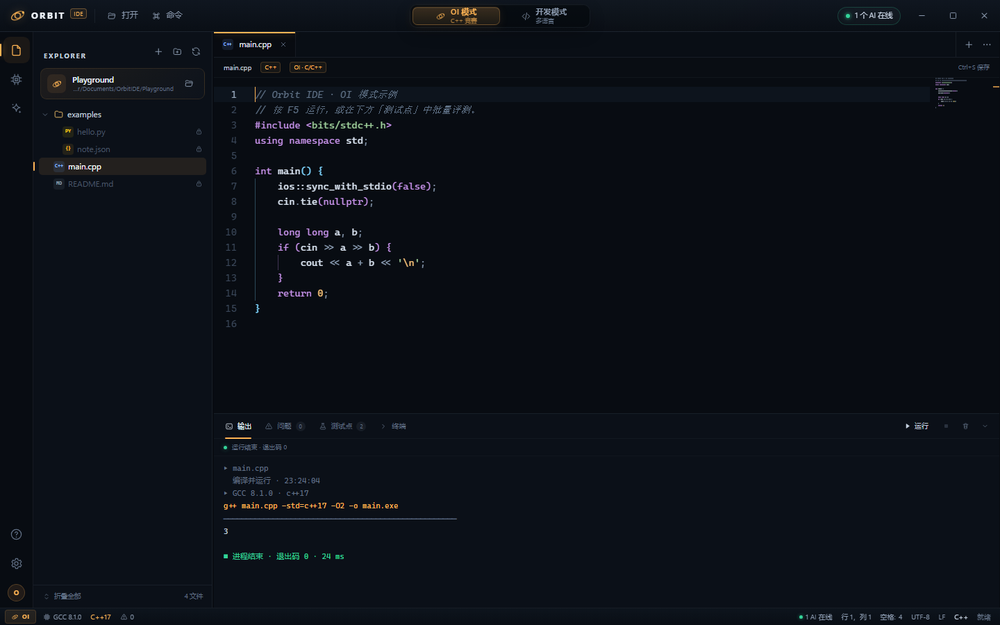
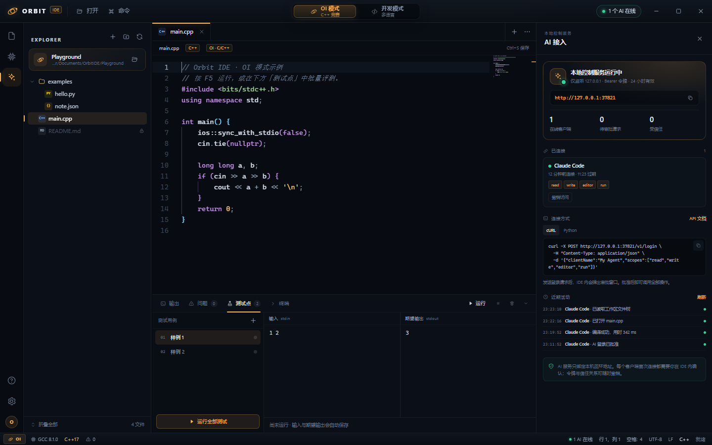

# Orbit IDE

> 双模式、AI 原生、开箱即用的桌面 IDE。OI 竞赛只留 C/C++，开发模式放开多语言；所有核心操作都能由外部 AI 通过本地 HTTP 接口在用户批准后直接调用。



## 界面预览

| OI 模式 · 编译器自动匹配 | 开发模式 · 多语言 |
| --- | --- |
|  |  |

| AI 审批 | 自动补全 |
| --- | --- |
|  |  |

| 欢迎页 | 运行输出 |
| --- | --- |
|  |  |

## 特性

- **双模式随时切换**
  - **OI 模式**：仅允许 C/C++，自动聚焦编译器、标准与测试点；非 C/C++ 文件在资源管理器中上锁。
  - **开发模式**：C/C++、Python、JavaScript、TypeScript、Java、Go、Rust、JSON、Markdown、HTML/CSS 等。
  - 切换时自动保存并关闭不兼容标签，界面主题色、面板和工具链选择同步变化。
- **Monaco 编辑器**
  - 语法高亮、括号着色、缩进参考线、多光标、查找替换、代码折叠、小地图。
  - C/C++ 关键字与标准库符号补全（参考 VSCode 当前 C/C++ 补全词库），启动时解析当前编译器实际使用的系统头文件（如 `stdint.h`）并缓存词条；保留常用循环/排序等轻量片段，已移除工程模板与模板类片段；Python/JS/TS/Go/Java/Rust 片段补全；JS/TS 由 TypeScript 语言服务提供补全与诊断。
  - 编译错误/警告解析后写入编辑器 Problems（行内波浪线）与问题面板。
- **编译器自动扫描**
  - 扫描 `PATH`、MinGW、MSYS2、LLVM、JDK、Python、Node、Go、Rust 等常见安装位置，也支持在设置中选择额外的递归扫描目录，以及手动添加任意可执行文件。
  - 对每个 C/C++ 编译器**实际尝试编译**来探测其支持的全部标准（C++98/03/11/14/17/20/23/26，含 `c++2a` 等草案别名），而不是写死版本表。
  - 切换编译器后自动匹配可用标准；OI 模式优先 C++17，开发模式优先最新标准。
  - GCC 8 的 `bits/stdc++.h` 与 C++17 存在已知不兼容：检测到该组合且编译失败时，自动回退 C++14 并在输出/问题面板提示，不会把首轮错误噪音展示给用户。
- **运行与评测**
  - F5 编译并运行，支持交互式 stdin；Ctrl+Shift+B 仅编译；可在设置中开关 `-O2` / `/O2` 优化。
  - OI 测试点：CPH-NG 风格三段布局（测试点列表 / 输入 / 答案与程序输出），逐点显示运行时间，支持单点与全部运行、删除/清空，以及 100–60000 ms 可配置超时；数据保存在 `.orbit/tests.json`。
  - 内置单次命令终端（PowerShell），以及输出、问题、测试点、终端四个面板。
- **AI 接入（核心差异化）**
  - 本地 HTTP 服务只监听 `127.0.0.1`，通过 `POST /v1/login` 发起接入请求。
  - IDE 内弹出审批窗口，展示客户端名称、来源、请求权限；批准后发放 24 小时 Bearer Token。
  - 覆盖文件、编辑器、构建运行、终端、测试点、模式、编译器、设置、界面通知等 39 个操作，也可通过 `POST /v1/execute` 统一调用。
  - 支持“记住客户端”（需提供 `clientId`）、在线会话撤销、审计日志。
  - OI 模式在**服务端**强制限制非 C/C++ 文件写入与运行，不只是 UI 限制。
- **体验细节**
  - 自绘无边框窗口、命令面板、快速打开、文件树右键菜单、标签页管理、可拖拽侧边栏/底部面板、通知与设置弹窗。
  - 首次启动自动创建示例工作区，内置 A+B 示例；测试点默认为空，可自行添加。

## 快速启动

### 使用打包版（推荐）

```
release\Orbit IDE-1.0.0-win-x64\Orbit IDE.exe
```

同目录还提供：

- `启动 Orbit IDE.bat`：批处理启动（开发/调试友好）。
- `创建桌面快捷方式.bat`：在桌面创建带图标的快捷方式。
- `使用说明.txt`：离线说明。

整个文件夹即为便携版，可整体拷贝。设置保存在 `%APPDATA%\Orbit IDE\settings.json`。

### 开发调试

```bat
start-dev.bat
```

或：

```bash
npm install
npm run dev
```

### 重新打包

```bash
npm run package:app
```

产物输出到 `release\Orbit IDE-1.0.0-win-x64\`。如需 zip：

```powershell
Compress-Archive -Path "release\Orbit IDE-1.0.0-win-x64\*" -DestinationPath "release\Orbit-IDE-1.0.0-win-x64.zip"
```

## AI 接入

1. 打开 IDE 右上角 **AI 接入**。
2. 复制本地地址（默认 `http://127.0.0.1:37821`，端口被占用时自动顺延）。
3. AI 客户端调用 `POST /v1/login`：

```bash
curl -X POST http://127.0.0.1:37821/v1/login \
  -H "Content-Type: application/json" \
  -d '{"clientName":"My Agent","clientId":"my-agent-001","scopes":["read","write","editor","run"]}'
```

4. 在 IDE 弹出的窗口中点击「允许接入」。
5. 轮询响应里的 `poll` 地址获取 `token`，之后请求携带：

```
Authorization: Bearer <token>
```

完整接口、操作列表、示例与错误码见 [docs/AI-API.md](docs/AI-API.md)，运行中也可访问 `GET /v1/docs` 或 `GET /v1/openapi.json`。



## 快捷键

| 操作 | 快捷键 |
| --- | --- |
| 保存 / 全部保存 | `Ctrl+S` / `Ctrl+Shift+S` |
| 新建文件 | `Ctrl+N` |
| 打开文件夹 | `Ctrl+O` |
| 快速打开 | `Ctrl+P` |
| 命令面板 | `Ctrl+Shift+P` |
| 编译 | `Ctrl+Shift+B` |
| 运行 / 停止 | `F5` / `Shift+F5` |
| 底部面板 | `` Ctrl+` `` |
| 关闭标签 | `Ctrl+W` |
| 切换侧边栏 | `Ctrl+B` |
| 格式化 | 浮动工具栏 / 命令面板 |

## 目录结构

```
orbit-ide/
├─ src/
│  ├─ main/                 Electron 主进程
│  │  ├─ main.cjs           窗口、IPC、app:// 协议、生命周期
│  │  ├─ compilers.cjs      编译器发现、版本/标准探测、自动匹配
│  │  ├─ runner.cjs         编译、运行、评测、诊断解析、终端
│  │  ├─ workspace.cjs      工作区路径沙箱、文件树、测试点存储
│  │  ├─ ai-server.cjs      AI HTTP 服务、Login 审批、令牌、操作注册表
│  │  ├─ settings.cjs       设置持久化
│  │  └─ languages.cjs      语言/扩展名/模板映射
│  ├─ preload/preload.cjs   contextBridge 安全桥
│  └─ renderer/             Monaco + 原生 JS 界面
│     ├─ index.html
│     ├─ main.js            应用状态与交互
│     ├─ editor.js          Monaco 主题、补全、诊断
│     ├─ styles.css
│     ├─ icons.js
│     └─ mock-orbit.js      浏览器无头预览用 Mock（仅 ?mock=1 启用）
├─ scripts/                 开发、打包、UI 截图、自动化测试
├─ docs/                    AI API 与截图
├─ build/                   图标
└─ release/                 .exe 打包产物
```

## 架构说明

- **主进程是唯一的特权层**：渲染进程通过 preload 暴露的白名单 IPC 访问文件、编译器、运行器。`nodeIntegration: false`、`contextIsolation: true`。
- **AI 接口与 UI 共用同一套能力**：AI 的编辑器操作会通过“主进程 → 渲染进程”的请求/响应桥执行，保证 AI 修改立即反映在界面上；文件读写则直接走工作区沙箱并广播刷新。
- **工作区路径校验**：所有路径解析到工作区根目录内，拒绝 `..` 穿越；OI 模式在写/运行入口再次校验扩展名。
- **生产页面使用自定义 `app://` 协议**：避免 `file://` 下 ES Module/Worker 的 CORS 限制，同时保持 `webSecurity` 开启；CSP 只允许自身资源与 `blob:` Worker。
- **编译标准探测**：对每个候选标准实际调用编译器 `-fsyntax-only`/`/c`，接受的标准才出现在 UI；探测结果按可执行文件指纹缓存，重扫时跳过未变化的编译器。
- **AI 安全模型**：本地回环绑定 + 每次新客户端人工审批 + 最小权限 scope + 24h 令牌 + 可撤销会话/信任关系 + 审计日志。

## 测试

```bash
node scripts/test-runner.cjs   # C++ 编译/回退/运行、Python、诊断、终端
node scripts/test-ai-api.cjs   # 登录审批、令牌、权限、文件 API、信任登录
node scripts/ui-capture.mjs    # 无头 Chromium 渲染与多状态截图（需 Vite dev server）
```

> 当前自动化环境是无交互桌面的 Windows 会话，Electron/记事本都无法创建可见窗口，因此 GUI 通过 Chromium 无头渲染验证；打包版的实际窗口需在正常桌面会话中启动。

## 已知边界

- C/C++ 智能补全基于 Monaco 词法、内置符号/片段与文档内单词，不是 clangd 级别的语义补全；若需要完整跳转/重构，可后续接入 clangd LSP。
- 调试器（断点/单步）未内置。
- 终端为单次 PowerShell 命令，不是持久 PTY。
- TypeScript 可编辑与补全，但暂未内置 `tsc` 运行配置。
- 标准探测验证的是“编译器接受该 `-std` 开关”，不保证 100% 语言一致性；GCC 8 的 `bits/stdc++.h` 兼容问题已单独兜底。
